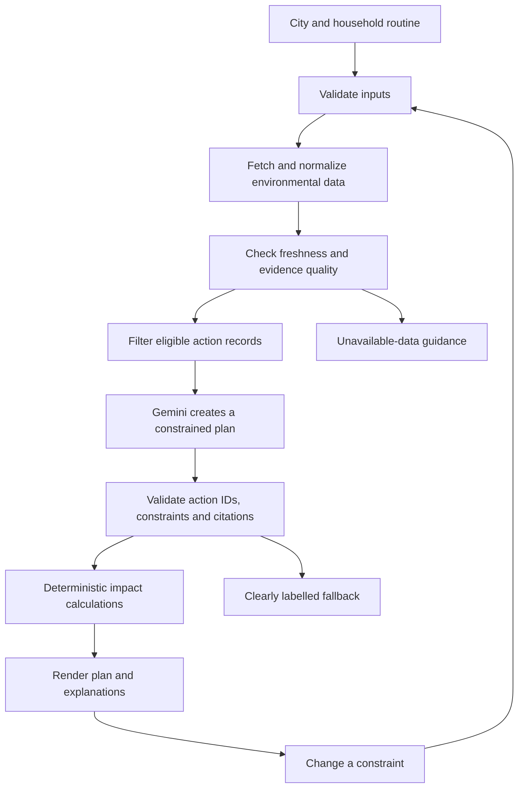

# Architecture and project creation

## Proposed stack

Python + FastAPI + Pydantic for the backend, Gemini through the official `google-genai` SDK, and a compact responsive frontend served from the same origin. Start with semantic HTML/CSS and small JavaScript modules; adopt a larger frontend framework only if complexity requires it. This minimizes deployment and integration work while preserving design freedom.

FastAPI supports typed request bodies and API testing through its documented [request models](https://fastapi.tiangolo.com/tutorial/body/) and [TestClient](https://fastapi.tiangolo.com/tutorial/testing/). The [Google Gen AI SDK](https://github.com/googleapis/python-genai) supports async requests and structured responses. A schema constrains structure, not truth: handle missing/invalid parsed output and validate semantics yourself. SDK docs were queried through Context7 during research. Pin versions only after an environment compatibility check; no current model ID or price is assumed.

## Request flow



## Responsibilities

| Component | Owns | Must not own |
|---|---|---|
| Provider adapter | Fetch, parse, normalize, provenance | Medical advice |
| Rules | Feasibility, data validity, applicable evidence | Invented observations |
| Gemini | Plain-language reasoning and feasible plan composition | AQI calculation, carbon arithmetic, source invention |
| Calculator | Units, factors, differences | Assumptions hidden from users |
| UI | Inputs, decisions, explanations | Secret API keys |

## Suggested source tree

```text
app/
  main.py
  config.py
  schemas.py
  api/{air,plan,compare,sources}.py
  providers/{base,ogd,open_meteo}.py
  services/{planner,rules,impact,evidence}.py
  static/{index.html,styles.css,app.js}
knowledge/{actions,sources}.json
tests/{unit,integration,evaluation}/
docs/{architecture,data-methods,evaluation,privacy}.md
pyproject.toml
.env.example
.gitignore
Dockerfile
```

This tree is a blueprint, not existing application code. Avoid adding provider modules that the feasibility spike rejects.

## API contracts

| Route | Input / output |
|---|---|
| `GET /api/air` | Validated city/location → normalized context and provider status |
| `POST /api/plan` | Routine, constraints, locale → validated actions, caveats, evidence IDs, generation mode |
| `POST /api/compare` | Baseline and candidate routines → deterministic changes, assumptions, unavailable estimates |
| `GET /api/sources/{id}` | Allowlisted ID → curated source metadata |
| `GET /health` | Readiness without secrets or personal context |

The server fetches trusted context itself. Never trust an AQI, evidence URL, or price supplied by the browser as authoritative. Include an input fingerprint in plans and reject late responses from old profiles after the user changes city or constraints.

`PlanAction` fields: action ID, time window, affected routine, reason, evidence IDs, resources, tradeoff, assumptions. `PlanResponse` additionally includes source time, context version, model ID, generation mode, warnings, and calculation status. All cited IDs must resolve to the curated evidence catalogue.

## Gemini call policy

1. Build a compact context containing normalized conditions, constraints, and eligible action records.
2. Treat user text and source excerpts as data, not instructions.
3. Ask for structured JSON using a Pydantic response schema.
4. Validate output structure, allowed IDs, feasibility, source support, and numerical claims.
5. Allow at most one bounded repair attempt. On failure, return reviewed rule-based guidance labelled “AI planning unavailable.”
6. Render only after validation. A streamed partial JSON answer must not appear as approved guidance.

Do not make clinical validation depend solely on a second model’s opinion. Safety-sensitive statements should come from approved action text; free-form content must not override it.

## Project setup sequence

1. Open this folder in Google Antigravity and supply the implementation brief.
2. Inspect installed Python and package tooling; choose a mutually supported stable Python/dependency set.
3. Create a project-local virtual environment and a dependency manifest/lockfile. Baseline dependencies: FastAPI, Uvicorn, Pydantic, HTTPX, google-genai; development dependencies: pytest and a formatter/linter.
4. Add `.gitignore` before secrets or generated artifacts. Add `.env.example` with placeholders only: `GEMINI_API_KEY`, `GEMINI_MODEL`, selected provider credentials, timeout and quota settings.
5. Implement schemas and one provider probe. Validate one success, one malformed response, and one unavailable response before UI expansion.
6. Implement one reviewed action family and a real Gemini request; record model availability and actual latency.
7. Build the end-to-end mobile page, then the rest of the P0 scope.
8. Add container packaging and documented startup instructions. Deploy only once the local flow and secrets handling work.

## Data and privacy

Use city-level location by default. Keep household details in memory for the session; make local saving opt-in and deletable. Do not put sensitive profile data into URLs or ordinary logs. Explain what is sent to the model provider. Record consent before persisting optional health-related flags; prefer broad categories over diagnoses. A shared/exported plan should omit personal details by default.

No database is required for the first version. Versioned JSON stores advice and metadata. If persistent profiles are later needed, add authenticated access and deletion before collecting them.

## Reliability and operating budget

Proposed initial limits: one generation in flight per session; bounded input length; provider timeouts; at most one model repair; per-session and service-wide request limits. Never log keys or full household prompts. Cache only data whose terms permit it; maintain separate freshness policies per provider.

Track request duration, provider failures, invalid plans, model token usage and aggregate cost without personal content. Estimate cost from measured input/output tokens times the selected model’s current rates plus provider and hosting charges. Set provider quotas and application hard caps; a budget alert alone does not stop spending.

Target on the chosen deployment: ordinary UI interactions below 200 ms, useful loading feedback immediately, and most plan requests below 10 seconds after warmup. These are design targets requiring measurement, not performance claims.

Deployment choice is deferred until a budget and account are available. One container and same-origin static assets are sufficient. Test a fresh anonymous visit, restart recovery, HTTPS, denied location permission and upstream failure on the actual deployed URL.
